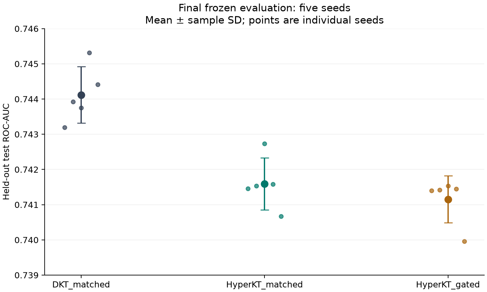

# HyperKT Knowledge Tracing

Objective 1 research repository for the HyperKT knowledge-tracing study. It preserves the supplied code, stage results, graphs and selected model checkpoints, explains the experimental sequence, and distinguishes recorded evidence from unsubstantiated manuscript claims.

> **Research status:** one ASSISTments2009 data source; independent baseline implementations; no demonstrated HyperKT ROC-AUC superiority. This repository is a reproducibility and evidence release, not certification of journal readiness, official baseline fidelity, calibrated Bayesian uncertainty or causal prerequisite discovery.

## Start here

- **[Research walkthrough](docs/RESEARCH_WALKTHROUGH.md):** the complete progression from data preparation through frozen held-out evaluation, with a page for each experimental stage.
- **[Results and interpretation](docs/RESULTS.md):** final five-seed metrics, graph-learning diagnostics, negative results and uncertainty caveats.
- **[Reproduction guide](docs/REPRODUCIBILITY.md):** public checks, figure generation, checkpoint verification, original notebook workflow and what requires privately obtained data.
- **[Audit and limitations](docs/AUDIT_AND_LIMITATIONS.md):** what was checked, what was not, CPU/CUDA numerical differences and conditional protocol status.
- **[Data and privacy](docs/DATA_AND_PRIVACY.md):** provenance, cleaning/splitting, exclusions and unresolved redistribution terms.
- **[Checkpoint guide](docs/CHECKPOINTS.md):** final versus historical weights and safe loading.
- **[Code availability](docs/CODE_AVAILABILITY.md):** repository and versioned release links, with suggested manuscript wording.
- **[Manuscript claim audit](docs/MANUSCRIPT_CLAIM_AUDIT.md):** warnings for all three supplied historical drafts, including the file named `CODE_ALIGNED`.

## Final held-out results

These are means and sample standard deviations across seeds 42, 123, 2024, 3407 and 7777. The test evaluation contains 32,522 next-response targets from 402 eligible learners, not 417 evaluated learners.

| Model | ROC-AUC, mean ± SD | F1, mean |
| --- | ---: | ---: |
| DKT_matched | 0.744119 ± 0.000798 | 0.812068 |
| HyperKT_matched | 0.741595 ± 0.000738 | 0.814366 |
| HyperKT_gated | 0.741153 ± 0.000670 | 0.813631 |

DKT has higher observed ROC-AUC in every final seed. Most learner-cluster paired bootstrap intervals overlap zero; do not reinterpret these results as robust population-level superiority for either model. F1 uses a fixed 0.5 threshold and is not interchangeable with ROC-AUC.



## Repository contents

```text
notebooks/       22 unchanged original Colab notebooks, without saved outputs
src/hyperkt/     exact AST-exported Stage 10 model classes and safe loader
results/         original aggregate stage tables, reports, graphs and structures
figures/         publication-neutral plots regenerated from supplied tables
scripts/         aggregate validation, plotting, checkpoint and private-data audits
tests/           automated public-evidence, code, privacy-boundary and model checks
analysis/        aggregate reports from checks performed for this release
provenance/      hashes, inherited-file inventory and explicit exclusions
docs/            research narrative, stage pages, reproduction and limitations
archive/         unchanged historical manuscripts and source-package notes
```

Model binaries are distributed as curated [release assets](https://github.com/dharavathshivanayak201-debug/HyperKT-Knowledge-Tracing/releases) and are absent from the main branch. A temporary same-repository branch used solely for release upload was deleted after publication; learner interaction records, ID split lists, sequence arrays and learner-level predictions are excluded from both the public repository and checkpoint ZIPs.

## Quick start

```bash
git clone https://github.com/dharavathshivanayak201-debug/HyperKT-Knowledge-Tracing.git
cd HyperKT-Knowledge-Tracing
python -m venv .venv
source .venv/bin/activate
python -m pip install -r requirements-audit.txt
python scripts/verify_public.py
python -m unittest discover -s tests -v
python scripts/make_figures.py
```

Install the CPU PyTorch wheel for synthetic model tests or checkpoint verification:

```bash
python -m pip install torch==2.11.0 --index-url https://download.pytorch.org/whl/cpu
python -m unittest discover -s tests -v
```

This quick start verifies public artifacts and regenerates figures. It does not retrain models or reproduce the private learner-level dataset.

## Architecture, evidence and rights

The final HyperKT combines a causal transformer, positional-distance attention decay and fixed pretrained skill-to-hyperedge assignments with learnable edge embeddings and fusion. It predicts a sigmoid probability trained with binary cross-entropy; the early Beta-head experiment is not the final predictor, and sequence-position distance is not elapsed time.

The supplied work is attributed in the historical manuscript to Raghu Dhumpati and Venkata Ramana Veeramsetty; that is supplied metadata, not independently verified authorship. No software or model license was supplied or selected by the rights holder, so public availability is not an open-source license or permission to redistribute the underlying data. See [rights notice](RIGHTS.md) and [citation metadata](CITATION.cff).
