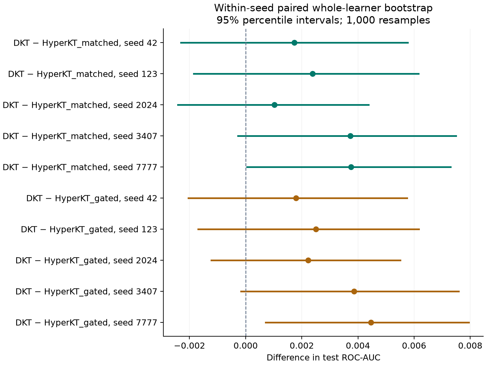

# Results and scientific interpretation

The final evaluation is the Stage 10 frozen-checkpoint test, not the early graph-reconstruction task or the validation/model-selection experiments. All numbers below come from the supplied aggregate files and the release audit; no new model was trained for this repository.

## Final knowledge-tracing evaluation

| Variant | ROC-AUC mean | ROC-AUC sample SD | NLL mean | Brier mean | F1 mean | ECE15 mean |
| --- | ---: | ---: | ---: | ---: | ---: | ---: |
| DKT_matched | 0.744119363463 | 0.000798191824 | 0.548552288243 | 0.184289684227 | 0.812068347355 | 0.011439652241 |
| HyperKT_matched | 0.741595208243 | 0.000738364052 | 0.549061145718 | 0.184389899719 | 0.814365761275 | 0.015040742644 |
| HyperKT_gated | 0.741152939946 | 0.000669732394 | 0.549185820454 | 0.184487092656 | 0.813631101856 | 0.011974471224 |

The full precision table, including accuracy, precision and recall, is [five_seed_test_summary.csv](../results/hyperkt_stage10/five_seed_test_summary.csv); individual runs are [per_seed_test_metrics.csv](../results/hyperkt_stage10/per_seed_test_metrics.csv). The public verification script reconstructs every listed mean and sample SD from the 15 per-seed rows at absolute tolerance 1e-12.

- **ROC-AUC:** DKT exceeds both HyperKT variants in every seed; its mean difference from original HyperKT is about 0.002524.
- **F1:** original HyperKT has the highest observed mean at the fixed 0.5 threshold; this does not establish superiority on discrimination, calibration or educational outcomes.
- **Repeated seeds:** variability covers model training with one fixed Stage 3B structure and one learner split, not independent datasets or independently relearned hypergraphs.
- **Sample:** all 15 checkpoints are scored on the same 32,522 targets from 402 eligible test learners; the 417 raw split learners include 15 singletons with no next-response target.

## Bootstrap uncertainty

Stage 10 supplies 1,000-resample whole-learner bootstrap intervals for each checkpoint and paired DKT-minus-comparator differences within each seed. The release audit reproduced all 15 individual and 10 paired percentile intervals exactly to 1e-12 using weighted tied-score AUC, with seed + 10000 for individual intervals and seed + 19000 for paired intervals.

Four of five DKT-minus-original-HyperKT paired intervals include zero. These are conditional within-seed learner-sampling intervals, not a pooled confidence interval over training randomness or datasets; there is no demonstrated robust population-level superiority claim.

See [paired comparisons](../results/hyperkt_stage10/paired_auc_comparisons.csv), [individual intervals](../results/hyperkt_stage10/student_cluster_auc_intervals.csv) and [aggregate reconstruction](../analysis/private-artifact-audit.json). Public readers can inspect those tables but need privately held prediction rows to recompute the bootstrap from learners.

## Earlier stages and negative findings

- **Original graph learning:** the Stage 3 reconstruction has near-constant predictions and worse MSE than a constant baseline; it is retained as a failed diagnostic, not evidence of discovered prerequisites.
- **Repaired graph learning:** Stage 3B graph edge test AUC is 0.867123 versus 0.886976 for the degree-product baseline; this is an edge-prediction task on training-derived co-occurrence, not learner test ROC-AUC.
- **Early temporal/fusion experiment:** Stage 4 best validation AUC is 0.756826 temporal-only and 0.757777 with hypergraph fusion; these single-seed validation findings do not override final test results.
- **Uncertainty experiment:** Stage 5 deterministic validation AUC is 0.758523 and MC30 AUC is 0.758921; Beta concentration is explicitly unidentifiable from binary BCE and dropout variance is only an approximate diagnostic.
- **Fine-tuning:** Stage 6 selected epoch 0, leaving the initial model unchanged under its validation criterion.
- **Gated fusion:** the final gated variant does not improve original HyperKT test AUC and remains a negative ablation.
- **Baseline fairness:** Stage 9E matches batch size and training budget, not architecture or parameter count; DKT has 190,231 parameters, original HyperKT 512,529 and gated HyperKT 512,530.

The unchanged historical reports and generated validation plots are labelled by stage. Do not combine validation and held-out results into a single leaderboard or describe graph edge AUC as knowledge-tracing performance.

## CPU inference verification

The release additionally reran all 15 frozen checkpoints on the supplied private test windows using CPU PyTorch 2.11.0. All checkpoint hashes, strict state loads, finite tensor checks and future-perturbation causal probes passed; no training or model selection occurred.

HyperKT probability differences from saved CUDA predictions are below 3e-7. The DKT CPU probabilities differ by up to approximately 0.00124723, with maximum AUC difference below 1e-6 and small threshold-sensitive metric changes; the five DKT agreement-at-1e-5 flags are retained as false rather than relabelled passes. The precise numerical cause was not isolated, so backend/hardware drift is a possible explanation, not a proven diagnosis.

See [checkpoint-verification.json](../analysis/checkpoint-verification.json) for all 15 records. Saved-output metric reconstruction at 1e-12 and checkpoint-driven CPU inference are separate checks with different numerical conclusions.
